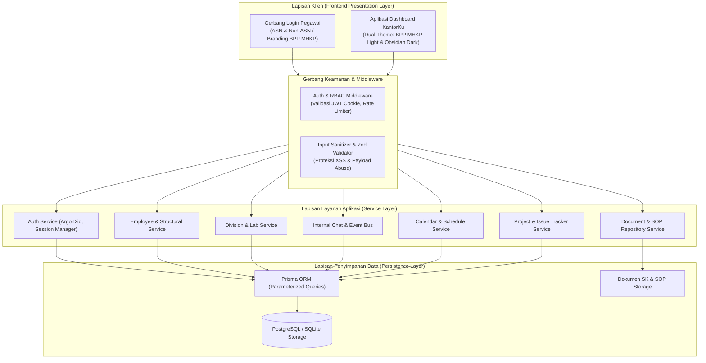
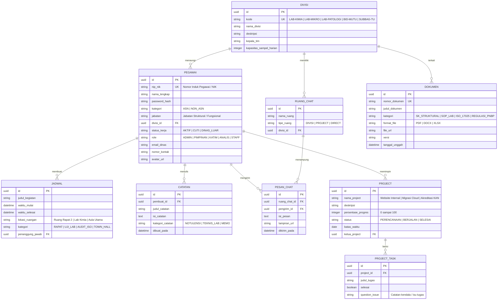

# Architecture.md — Arsitektur Sistem Internal KantorKu
## Proyek: Portal Internal BUSPMHKP (Berbasis Desain Institusi BPP MHKP)

---

### 1. Topologi Arsitektur Sistem (Internal Single-Gateway Architecture)

Sistem dirancang sebagai **Enterprise Internal Workplace Portal** yang terisolasi dan terlindungi oleh gerbang otentikasi tunggal (*Gated Internal Portal*).



---

### 2. Struktur Routing Aplikasi (Gated Route Hierarchy)

Seluruh halaman berada di balik middleware otentikasi, kecuali route login:

```text
buspm-portal/
├── src/
│   ├── app/
│   │   ├── login/
│   │   │   └── page.tsx            # Gerbang Login Pegawai ASN & Non-ASN
│   │   │
│   │   ├── (protected)/            # Route Group terlindungi autentikasi sesi
│   │   │   ├── layout.tsx          # Shell Navigasi: Header BPP MHKP, Sidebar, Theme Toggle
│   │   │   ├── page.tsx            # Root redirect ke /dashboard
│   │   │   ├── dashboard/          # Modul 1: Overview Metrik, Jadwal & Progres Project
│   │   │   │   └── page.tsx
│   │   │   ├── pegawai/            # Modul 2: Direktori Pegawai & Question/FAQ Box
│   │   │   │   └── page.tsx
│   │   │   ├── struktural/         # Modul 3: Bagan Organisasi & Dokumen SK
│   │   │   │   └── page.tsx
│   │   │   ├── divisi/             # Modul 4: Unit Laboratorium Pengujian (LAB)
│   │   │   │   └── page.tsx
│   │   │   ├── chat/               # Modul 5: Chat Divisi, Project & Pesan Langsung
│   │   │   │   └── page.tsx
│   │   │   ├── jadwal/             # Modul 6: Kalender Operasional Uji & Rapat
│   │   │   │   └── page.tsx
│   │   │   ├── pengumuman/         # Modul 7: Papan Pengumuman Resmi Balai
│   │   │   │   └── page.tsx
│   │   │   ├── catatan/            # Modul 8: Notulensi Rapat & Memo Teknis Lab
│   │   │   │   └── page.tsx
│   │   │   ├── project/            # Modul 9: Pelacakan Milestone Project & Isu
│   │   │   │   └── page.tsx
│   │   │   └── docs/               # Modul 10: Repositori Dokumen SOP, ISO 17025 & PNBP
│   │   │       └── page.tsx
│   │   │
│   │   └── api/                    # Endpoint API Internal
│   │       ├── auth/
│   │       │   ├── login/route.ts
│   │       │   ├── logout/route.ts
│   │       │   └── me/route.ts
│   │       ├── pegawai/route.ts
│   │       ├── struktural/route.ts
│   │       ├── divisi/route.ts
│   │       ├── chat/route.ts
│   │       ├── jadwal/route.ts
│   │       ├── catatan/route.ts
│   │       ├── project/route.ts
│   │       └── docs/route.ts
```

---

### 3. Skema Data Terintegrasi (Entity-Relationship Model)



---

### 4. Arsitektur Keamanan (Enterprise Defense Matrix)

1. **Gated Middleware Protection:**
   - Semua request ke modul internal diuji token JWT-nya via middleware. Sesi yang kedaluwarsa atau tidak valid langsung dialihkan ke `/login`.
2. **Proteksi Kredensial & Session:**
   - Hashing password menggunakan **Argon2id** dengan salt acak berukuran 16 byte.
   - Token disimpan di dalam cookie `HttpOnly`, `Secure`, `SameSite=Strict`.
3. **Anti-SQL Injection:**
   - Seluruh mutasi dan filter query dijalankan lewat layer ORM Prisma yang terparameterisasi.
4. **Anti-XSS & Content Security Policy:**
   - Form input pada modul Catatan, Chat, dan Pengumuman disanitisasi menggunakan Zod schema sebelum disimpan ke database dan di-escape saat proses render.
5. **Anti-IDOR (Insecure Direct Object Reference):**
   - Setiap mutasi catatan dan profil memvalidasi kepemilikan data (`pegawai.id === session.userId` atau role `ADMIN`).

---

### 5. Strategi Desain Visual & Dark Mode Engine

* **Default Mode (BPP MHKP Institutional Brand):**
  - Mengadaptasi elemen visual resmi: header navy/marine blue (`#0066B3`), aksen amber emas (`#F37023`), kartu putih bersih dengan bayangan lembut, dan banner resmi KKP.
* **Alternative Mode (High-Contrast Obsidian Dark Mode):**
  - Mengubah surface latar belakang menjadi Obsidian (`#0F1117`), card surface (`#181C27`), teks kontras tajam (`#F8FAFC`), dan aksen biru kobalt dinamis (`#2563EB`).
* **Anti-AI Slop Implementation:**
  - Status ketersediaan menggunakan badge tipografi terstruktur rapi. Tidak menggunakan `animate-pulse` dot hijau di seluruh modul.
