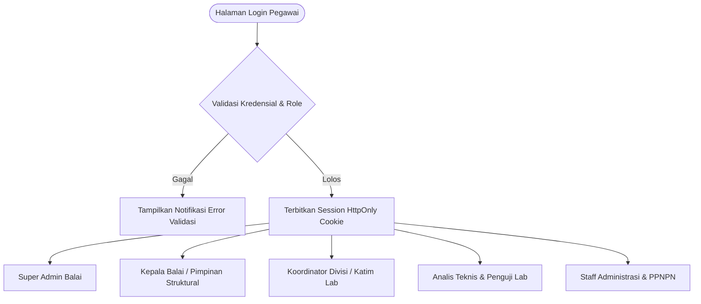
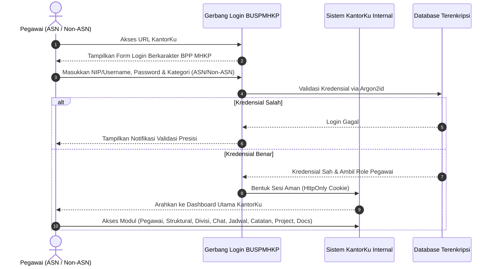

# Product Requirements Document (PRD) — Revisi Terfokus
## Portal Internal BUSPMHKP ("KantorKu — Sistem Operasional Internal Balai")
### Visual Identity: BPP MHKP Institutional Design System

---

### 1. Ringkasan Eksekutif & Penegasan Ruang Lingkup

**Balai Uji Standar Karantina Ikan, Pengendalian Mutu dan Keamanan Hasil Perikanan (BUSPMHKP / BPP MHKP)** telah memiliki portal publik eksternal terpisah. Fokus proyek ini **100% adalah Portal Internal Pegawai (KantorKu)** yang diperuntukkan bagi seluruh aparatur ASN dan Non-ASN di lingkungan BUSPMHKP.

**Karakteristik Kunci Solusi:**
1. **Wajib Login di Awal (Gated Authentication):** Pengguna tidak dapat mengakses sistem sebelum berhasil login melalui portal autentikasi resmi pegawai (ASN / Non-ASN lingkup BUSPMHKP).
2. **Visual Identity Portal Publik BPP MHKP:** Alih-alih antarmuka generik yang kaku, seluruh dashboard, sidebar, kartu metrik, dan tombol mengadopsi bahasa desain visual resmi BPP MHKP (Deep Marine Blue `#0066B3`, Warm Amber/Gold `#F37023`, Ocean Cyan `#00AEEF`, dan Clean White Canvas) dengan dukungan Dark Mode Obsidian yang kontras dan elegan.
3. **9+1 Modul Operasional Lengkap:** Mengintegrasikan seluruh kebutuhan kerja yang tertuang dalam catatan lapangan dan mockup:
   - Dashboard Eksekutif
   - Data Pegawai (ASN & Non-ASN)
   - Bagan Struktural Organisasi & Dokumen SK
   - Divisi & Unit Laboratorium Pengujian (LAB)
   - Chat Tim & Grup Komunikasi Internal
   - Jadwal Kegiatan & Kalender Pengujian
   - Catatan & Notulensi Rapat
   - Pelacakan Project & Milestone Balai
   - Repositori Dokumen SOP, ISO 17025 & Regulasi
   - Papan Siaran Pengumuman Resmi

---

### 2. Sasaran Pengguna & Hak Akses (User Roles & RBAC)

Sistem hanya dapat diakses oleh personil internal yang telah memiliki akun terdaftar:

1. **Super Admin:** Manajemen akun pegawai, penugasan divisi, audit log keamanan, pemeliharaan sistem.
2. **Pimpinan Balai / Struktural:** Monitoring metrik seluruh balai, persetujuan proyek, broadcast pengumuman resmi, disposisi jadwal.
3. **Koordinator / Katim Lab:** Monitoring progres pengujian laboratorium, jadwal kalibrasi alat, koordinasi via grup chat divisi.
4. **Analis Teknis & Staff (ASN / Non-ASN):** Akses jadwal tugas lab harian, pengisian notulensi catatan, komunikasi tim, unduh dokumen SOP ISO 17025.

---

### 3. Arsitektur Alur Pengguna (User Flow)

---

### 4. Rincian Modul & Fitur Operasional

#### 4.1. Gerbang Autentikasi (Official Login Screen)
* **Visual Styling:** Mengadopsi branding BPP MHKP:
  - Header: Logo resmi BPP MHKP (*"Bring Safety through Quality"*).
  - Teks resmi: *"Portal Internal Pegawai ASN dan Non-ASN Lingkup BUSPMHKP"*.
  - Slogan instansi: *"Ekonomi Biru untuk Indonesia Emas"* & *"BerAKHLAK"*.
* **Form Inputs:**
  - Pilihan Kategori: Tab `Pegawai ASN` / `Pegawai Non-ASN`.
  - Input: NIP / NIK / Username dinas.
  - Input: Password terenkripsi dengan toggle tampilkan/sembunyikan sandi.
  - Tombol Masuk: Desain tombol oranye/amber khas BPP MHKP (`#F37023`) dengan ikon panah.
  - Tautan Bantuan / Kontak Helpdesk IT Balai.

---

#### 4.2. Header & Shell Dashboard Utama
* **Top Navigation Bar:**
  - Identitas: Mini logo BPP MHKP + label *"KantorKu — Portal Internal"*.
  - Global Search: Pencarian cepat pegawai, dokumen SOP, atau proyek.
  - Status Info: Nama balai (*Balai Uji Standar KIPM Jakarta Timur*).
  - Profil Pegawai: Avatar, Nama Lengkap, Divisi, dan Badge Kategori (ASN / Non-ASN).
  - Toggle Tema: Beralih antara **Light Theme BPP MHKP** (Marine Blue & Clean Slate) dan **Dark Theme Obsidian** (Slate Gelap).
  - Tombol Logout aman.

---

#### 4.3. Modul 1: Dashboard Eksekutif (Overview)
* **4 Kartu Metrik Bergaya BPP MHKP:**
  - *Total Pegawai*: Menampilkan jumlah personil (contoh: 10 pegawai).
  - *Pegawai Aktif*: Menampilkan personil yang sedang bertugas hari ini (contoh: 9 orang).
  - *Divisi Laboratorium*: Menampilkan jumlah unit teknis operasional (5 divisi/lab).
  - *Project Berjalan*: Menampilkan proyek strategis aktif (contoh: 2 proyek).
* **Widget Jadwal Terdekat:**
  - Menampilkan agenda terdekat (contoh: *Rapat Sprint Tim IT*, *Deadline Modul Chat*, *Town Hall Akhir Tahun*).
  - Dilengkapi blok tanggal geometris (Hari, Bulan) dan lokasi ruangan rapat.
* **Widget Progres Project:**
  - Baris progres proyek balai dengan persentase real-time (contoh: *Website Internal Perusahaan 55%*, *Migrasi Server Cloud 20%*, *Kampanye Promosi Q1 0%*).

---

#### 4.4. Modul 2: Data Pegawai (Directory & Question/FAQ)
* **Tabel Direktori Pegawai:**
  - Kolom: Foto Avatar, Nama Lengkap, NIP/NIK, Kategori (ASN / PPNPN), Divisi/Unit Kerja, Jabatan, Kontak, Status Kerja.
  - **Aturan Keras Status Ketersediaan (Anti-AI Slop):** Dilarang keras menggunakan titik hijau berkedip (`animate-pulse`). Wajib menggunakan badge tipografi minimalis:
    - *Aktif*: Badge hijau tua subtle berborder (`bg-emerald-50 text-emerald-700 border-emerald-300`).
    - *Cuti*: Badge amber subtle (`bg-amber-50 text-amber-700 border-amber-300`).
    - *Dinas Luar*: Badge biru navy subtle (`bg-blue-50 text-blue-700 border-blue-300`).
* **Fitur Filter & Search:** Penyaringan instan berdasarkan divisi atau kata kunci nama.
* **Question / Bantuan Pegawai:** Kotak tanya jawab internal (*FAQ & Question Box*) untuk mengajukan pertanyaan seputar administrasi kepegawaian.

---

#### 4.5. Modul 3: Struktural & Bagan Organisasi (Hierarchy & Bagan.Doc)
* **Bagan Organisasi Interaktif:** Visualisasi hierarki kepemimpinan balai dari Kepala Balai, Kasubbag Tata Usaha, hingga Katim teknis.
* **Repositori Dokumen SK Struktural (`Bagan.Doc`):** Panel unduh dokumen SK penunjukan pimpinan dan struktur organisasi resmi dalam format PDF berstempel dinas.

---

#### 4.6. Modul 4: Divisi & Unit Laboratorium Pengujian (LAB)
* Menampilkan kartu 5 unit laboratorium dan tata usaha:
  1. *Laboratorium Kimia & Residu Cemaran* (Instrumen GC-MS, LC-MS/MS, AAS).
  2. *Laboratorium Mikrobiologi & Biologi Molekuler* (Pengujian patogen, PCR, ELISA).
  3. *Laboratorium Patologi & Kesehatan Ikan* (Histopatologi dan parasitologi).
  4. *Bidang Standardisasi, Bahan Acuan & Uji Profisiensi* (Penyelenggara uji profisiensi nasional).
  5. *Subbagian Tata Usaha & Urusan Umum* (Administrasi kepegawaian dan BMN).
* Detail kapasitas uji harian, ketua tim divisi, dan log kegiatan lab.

---

#### 4.7. Modul 5: Chat & Grup Chat (Internal Collaboration)
* **Kanal Komunikasi Terstruktur:**
  - *Channel Divisi*: Ruang chat terisolasi untuk masing-masing divisi lab.
  - *Channel Project*: Ruang koordinasi proyek lintas divisi.
  - *Direct Message (DM)*: Komunikasi 1-on-1 antar pegawai balai.
* Fitur pengiriman teks, lampiran dokumen uji (.pdf, .xlsx), dan stempel waktu pengiriman.

---

#### 4.8. Modul 6: Jadwal & Kalender Operasional (Scheduling)
* Kalender agenda kegiatan terpadu (Rapat koordinasi, jadwal kalibrasi alat uji lab, audit surveillance KAN ISO/IEC 17025, jadwal piket lab).
* Modal pembuatan agenda baru dengan input tanggal, jam, ruangan/lab, dan peserta.

---

#### 4.9. Modul 7: Papan Pengumuman Resmi (Announcements)
* Siaran instruksi Kepala Balai, surat edaran Sekretariat Jenderal KKP, dan pengumuman kedinasan.
* Indikator label prioritas (*Sangat Penting*, *Umum*, *Sosialisasi*).

---

#### 4.10. Modul 8: Catatan & Notulensi Rapat (Notes & Technical Memos)
* Editor catatan cepat untuk notulensi rapat sprint, memo internal, dan catatan penanganan deviasi pengujian laboratorium.
* Fitur pencarian catatan dan tag kategori.

---

#### 4.11. Modul 9: Manajemen Project & Milestone (Project: Question)
* Pelacakan proyek balai (contoh: *Penyusunan Bahan Acuan Logam Berat Matriks Ikan Kakap*, *Audit Akreditasi ISO 17025:2017*, *Digitalisasi KantorKu*).
* Indikator capaian persentase bar, daftar milestone checklist, dan *Question / Issue Tracker* untuk mencatat kendala lapangan.

---

#### 4.12. Modul 10: Repositori Dokumen & SOP (Docs Compliance)
* Gudang dokumen tata kelola:
  - SOP Pengujian Laboratorium
  - Manual Mutu ISO/IEC 17025
  - Template Material Transfer Agreement (MTA) & Certificate of Analysis (CoA)
  - Salinan Regulasi Tarif PNBP KKP
* Akses unduh terlindungi dengan penandaan watermark nama pegawai yang mengunduh.

---

### 5. Persyaratan Non-Fungsional (NFR)

1. **Keamanan:**
   - Proteksi sesi berbasis cookie HttpOnly dan JWT payload.
   - Proteksi injeksi SQL (Prisma / parameterized query).
   - Sanitasi input form bebas serangan XSS via Zod schema parser.
2. **Kepatuhan Desain:**
   - Warna dan tipografi mengacu pada panduan visual BPP MHKP.
   - Zero animate-pulse green dot.
   - Aksesibilitas WCAG 2.1 AA (kontras minimal 4.5:1).
3. **Performa:**
   - Bundle size teroptimasi, initial load < 1.2 detik.
   - Dukungan responsif di layar monitor PC kantor, laptop, dan tablet pengawas lab.
