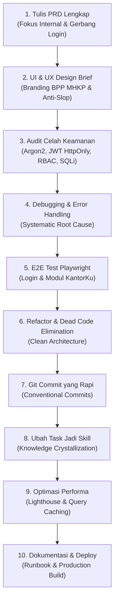

# workflow.md — Prosedur Standar & Alur Kerja 10 Langkah Pengembangan
## Proyek: Portal Internal BUSPMHKP (KantorKu — BPP MHKP Institutional Style)

Dokumen ini memetakan alur kerja standar (*Standard Operating Procedure*) yang wajib diikuti oleh tim pengembang dan agen AI dalam mengeksekusi proyek Portal Internal KantorKu berbasis visual BPP MHKP.

---

### Gambaran Umum Alur Kerja (10-Step Pipeline)

---

### Rincian 10 Langkah Pengembangan Aplikasi

---

#### Langkah 1: Tulis PRD Lengkap (Product Requirements Document)
* **Fokus Utama:** Portal internal terpadu pegawai (KantorKu) dengan gerbang login resmi ASN & Non-ASN.
* **Tindakan & Aktivitas:**
  1. Spesifikasi alur autentikasi login terproteksi sebelum pengguna dapat mengakses halaman kerja.
  2. Rincian 10 modul operasional: Dashboard Eksekutif, Data Pegawai (Directory & Question), Struktural (Bagan.Doc), Divisi (LAB), Chat & Grup, Jadwal, Catatan, Project (Milestone & Question), Docs (SOP ISO 17025), dan Pengumuman.
  3. Pemetaan kebutuhan teknis institusi BUSPMHKP di bawah Kementerian Kelautan dan Perikanan.
* **Gerbang Validasi (Gate Check):** Dokumen [`prd.md`](file:///C:/Users/Dell%203490/.gemini/antigravity/scratch/buspm-portal/prd.md) telah disahkan.

---

#### Langkah 2: Full UI & UX Design Brief
* **Fokus Utama:** Mengadaptasi elemen visual institusional BPP MHKP dari portal publik ke dalam portal internal pegawai.
* **Tindakan & Aktivitas:**
  1. Penetapan sistem warna resmi: Marine Blue (`#0066B3`), Amber/Oranye (`#F37023`), Cyan (`#00AEEF`), dan Clean Canvas White (`#F4F6F9`).
  2. Implementasi High-Contrast Dark Mode (Obsidian `#0F1117` & Slate `#181C27`) untuk kenyamanan kerja jangka panjang.
  3. Penegakan aturan keras **Anti-AI Slop**:
     - **DIHARAMKAN:** Menggunakan titik hijau berkedip (`animate-pulse`) pada status ketersediaan pegawai.
     - **DIWAJIBKAN:** Menggunakan badge tipografi rapi ber-border halus.
* **Gerbang Validasi (Gate Check):** Dokumen [`design.md`](file:///C:/Users/Dell%203490/.gemini/antigravity/scratch/buspm-portal/design.md) telah disahkan.

---

#### Langkah 3: Temukan Celah Keamanan (Security Audit & Hardening)
* **Fokus Utama:** Menutup kerentanan OWASP Top 10 pada portal internal kedinasan.
* **Daftar Periksa Keamanan (Security Checklist):**
  - [ ] **Otentikasi & Sesi:** Password di-hash menggunakan Argon2id. Token JWT disimpan dalam cookie `HttpOnly`, `Secure`, `SameSite=Strict`.
  - [ ] **SQL Injection:** Seluruh kueri wajib menggunakan parameterisasi ORM Prisma. Dilarang konkatenasi string SQL mentah.
  - [ ] **Cross-Site Scripting (XSS):** Semua input teks pada form catatan, chat, dan pengumuman disanitisasi menggunakan Zod schema sebelum disimpan.
  - [ ] **Role-Based Access Control (RBAC):** Validasi hak akses pada level route dan service (Admin, Katim, Analis, Staff).
  - [ ] **Rate Limiting:** Pembatasan percobaan login (maksimal 5 kali salah per 10 menit) untuk mencegah serangan brute force.
* **Gerbang Validasi (Gate Check):** Pengujian simulasi injeksi dan bypass autentikasi menghasilkan status tertolak (aman).

---

#### Langkah 4: Debug Error dengan Cepat (Systematic Debugging Protocol)
* **Fokus Utama:** Penanganan masalah secara terstruktur tanpa tebakan liar (*no speculative fixes*).
* **Protokol 4 Langkah:**
  1. *Identifikasi:* Catat pesan error lengkap dan langkah pemicunya.
  2. *Analisis Akar Masalah (Root Cause):* Telusuri kode dan data input sampai titik kegagalan ditemukan.
  3. *Hipotesis & Uji Terarah:* Bentuk hipotesis perbaikan tunggal dan buktikan dengan log verifikasi.
  4. *Implementasi & Regresi:* Terapkan solusi minimal dan uji kembali fitur terkait.
* **Gerbang Validasi (Gate Check):** Error teratasi tuntas dan diverifikasi dengan log bersih.

---

#### Langkah 5: E2E Test Aplikasimu (Playwright Automation)
* **Fokus Utama:** Otomasi pengujian seluruh alur penggunaan portal internal.
* **Skenario Uji Wajib (Playwright Suite):**
  1. *Test 1 - Gerbang Login:*
     - Percobaan login dengan password salah menampilkan pesan peringatan yang tepat.
     - Login sukses dengan kredensial ASN / Non-ASN mengarahkan ke dashboard utama.
  2. *Test 2 - Dashboard Utama:*
     - Verifikasi 4 kartu metrik (Total Pegawai, Pegawai Aktif, Divisi, Project Berjalan).
     - Verifikasi widget Jadwal Terdekat dan Progres Proyek.
  3. *Test 3 - Direktori Pegawai:*
     - Pengujian pencarian nama dan filter divisi.
     - Verifikasi tidak adanya elemen `animate-pulse` pada badge ketersediaan pegawai.
  4. *Test 4 - Modul Interaktif:*
     - Pengujian penambahan catatan baru pada modul Catatan.
     - Pengujian pengiriman pesan pada kanal chat divisi.
     - Verifikasi unduhan dokumen SK Struktural (`Bagan.Doc`).
* **Gerbang Validasi (Gate Check):** Seluruh suite Playwright berstatus hijau (100% lulus).

---

#### Langkah 6: Bersihkan & Refactor Dead Code
* **Fokus Utama:** Menjaga basis kode tetap efisien dan terstruktur (*lean code*).
* **Tindakan & Aktivitas:**
  1. Jalankan linter dan analisis dead-code untuk mendeteksi variabel/fungsi yang tidak terpakai.
  2. Hapus import redundan dan satukan komponen yang berulang (Button, Card, Badge, Modal) ke folder `components/ui/`.
  3. Terapkan prinsip `ponytail` (utamakan kode sederhana dibanding abstraksi berlebih).
* **Gerbang Validasi (Gate Check):** Zero warning pada ESLint dan TypeScript compiler check.

---

#### Langkah 7: Tulis Git Commit yang Rapi
* **Fokus Utama:** Riwayat commit yang bermakna dan atomik menggunakan standar Conventional Commits.
* **Standar Commit:**
  * `feat(auth): buat gerbang login pegawai asn dan non-asn berkarakter bpp mhkp`
  * `feat(dashboard): bangun layout dashboard kantorku dengan 4 kartu metrik`
  * `feat(pegawai): buat tabel direktori pegawai dengan badge status anti-slop`
  * `feat(struktural): integrasikan bagan organisasi dan unduh sk bagan.doc`
  * `security(auth): terapkan hashing password argon2id dan jwt httponly cookie`
  * `test(e2e): buat skrip pengujian playwright untuk alur login dan navigasi`
  * `refactor(ui): satukan token warna bpp mhkp dan dukungan obsidian dark mode`
  * `docs(readme): lengkapi panduan setup dan variabel lingkungan`
* **Gerbang Validasi (Gate Check):** Riwayat commit rapi dan mudah diaudit.

---

#### Langkah 8: Ubah Task Jadi Skill
* **Fokus Utama:** Mengkristalisasi solusi masalah khusus menjadi keahlian AI yang dapat digunakan berulang kali.
* **Tindakan & Aktivitas:**
  1. Dokumentasikan pola unik yang berhasil dibangun (misal: sistem penyesuaian tema dinas instansi KKP, validasi form ASN).
  2. Simpan pedoman teknis ke dalam folder `.agents/skills/` proyek.
* **Gerbang Validasi (Gate Check):** Dokumentasi reusable skill tersimpan rapi.

---

#### Langkah 9: Optimalkan Performa Aplikasi
* **Fokus Utama:** Menjaga latensi aplikasi tetap rendah untuk perangkat komputer operasional lab.
* **Tindakan & Aktivitas:**
  1. *Optimasi Rendering:* Gunakan server component dan lazy loading pada modal dokumen besar.
  2. *Data Caching:* Gunakan stale-while-revalidate pada kueri master pegawai dan divisi.
  3. *Core Web Vitals Target:*
     - LCP < 1.5 detik
     - CLS < 0.05
     - Skor Lighthouse >= 90
* **Gerbang Validasi (Gate Check):** Laporan audit performa memenuhi target.

---

#### Langkah 10: Buat Dokumentasi & Deploy
* **Fokus Utama:** Penyiapan panduan operasional teknis dan proses deployment ke production.
* **Tindakan & Aktivitas:**
  1. Lengkapi `README.md` dengan instruksi instalasi dependensi, migrasi database, dan pembuatan akun admin awal.
  2. Konfigurasi script build produksi (`npm run build`).
  3. Siapkan panduan deployment ke hosting (Vercel / VPS / Railway).
* **Gerbang Validasi (Gate Check):** Aplikasi ter-deploy dan dapat diakses dengan performa optimal.
